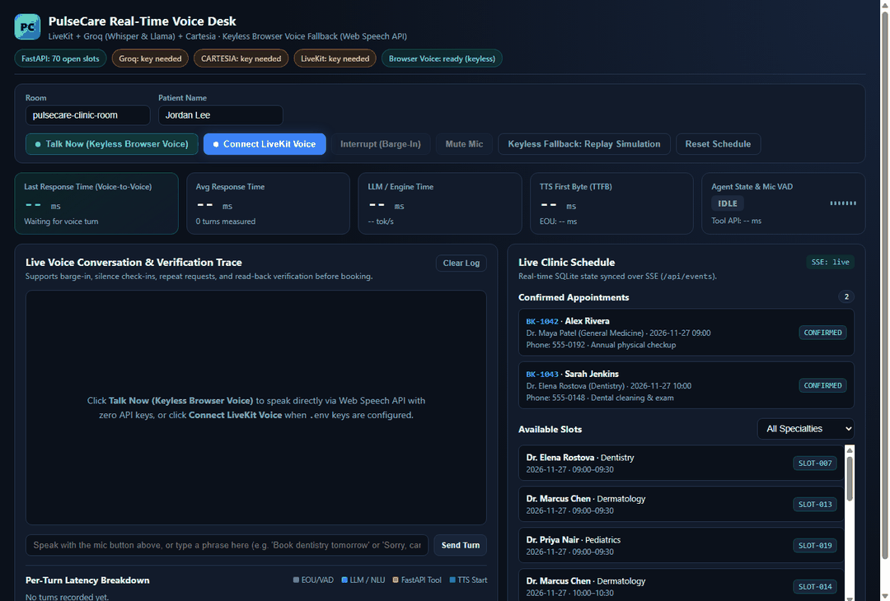

# PulseCare Voice Desk — Real-Time Voice Agent (LiveKit + Groq + FastAPI)

An ultra-low-latency AI voice receptionist for **PulseCare Medical & Dental Clinic**, built with:
- **LiveKit Agents (`~1.0`)**: Real-time WebRTC audio transport, Silero VAD turn-taking, and live telemetry data channel
- **Groq (`whisper-large-v3-turbo` + `llama-3.3-70b-versatile`)**: Low-latency Whisper STT and high-throughput LLM tool-calling inference
- **Cartesia (`sonic-2`) or Deepgram (`aura-2`)**: Streaming low-latency Text-to-Speech
- **FastAPI + SQLite**: Atomic appointment slot checking, booking, lookup, rescheduling, and cancellation with Server-Sent Events (`/api/events`)
- **Live Latency Dashboard**: Real-time transcript, per-turn response-time badges, latency waterfall (`EOU/VAD + Groq LLM TTFT + FastAPI Tool + TTS TTFB`), and live clinic schedule board



---

## Project Structure

```text
voice-clinic-agent/
├── agent/
│   ├── main.py             # LiveKit Agents worker (Groq STT + Groq LLM + Cartesia/Deepgram TTS)
│   ├── metrics_tracker.py  # Per-turn latency aggregator (EOU, STT, LLM TTFT, Tool ms, TTS TTFB)
│   └── tools.py            # Persistent HTTPX client calling FastAPI tools with timing telemetry
├── backend/
│   ├── db.py               # SQLite schema & seeded clinic doctors/slots/bookings
│   ├── main.py             # FastAPI clinic REST API, SSE stream, LiveKit token endpoint, static UI
│   └── models.py           # Pydantic request/response schemas
├── docs/
│   └── demo.gif            # Recorded UI & live FastAPI tool-call walkthrough
├── frontend/
│   ├── index.html          # Live voice console + latency waterfall + live clinic schedule
│   ├── styles.css
│   └── app.js              # LiveKit WebRTC client + DataChannel telemetry + Simulated Call walkthrough
├── scripts/
│   ├── benchmark_tools.py  # Cross-platform live loopback TCP + FastAPI + SQLite latency benchmark
│   └── run.py              # Cross-platform launcher (macOS, Linux, Windows)
├── tests/
│   ├── test_agent_tools.py
│   └── test_backend.py
├── pyproject.toml
└── requirements.txt
```

---

## Cross-Platform Setup (macOS, Linux, Windows)

### 1. Create Virtual Environment & Install Dependencies

**macOS / Linux (`bash` / `zsh`):**
```bash
python3 -m venv .venv
source .venv/bin/activate
pip install --upgrade pip
pip install -r requirements.txt
cp .env.example .env
```

**Windows (PowerShell):**
```powershell
python -m venv .venv
.\.venv\Scripts\Activate.ps1
pip install --upgrade pip
pip install -r requirements.txt
copy .env.example .env
```

Or use the cross-platform runner after creating `.venv` and installing dependencies:
```bash
# Works on macOS, Linux, and Windows (uses .venv automatically if present)
python scripts/run.py init-env
```

### 2. Configure API Keys (`.env`)

Fill in `LIVEKIT_URL`, `LIVEKIT_API_KEY`, `LIVEKIT_API_SECRET`, `GROQ_API_KEY`, and `CARTESIA_API_KEY` (or set `TTS_PROVIDER=deepgram` and `DEEPGRAM_API_KEY`).

### 3. Run the Application

Open two terminals in the project root:

**Terminal 1 — Start the FastAPI Clinic Service & Web UI:**
```bash
python scripts/run.py serve
```
Then open [http://127.0.0.1:8000](http://127.0.0.1:8000) (Swagger docs at [http://127.0.0.1:8000/docs](http://127.0.0.1:8000/docs)).

**Terminal 2 — Start the LiveKit + Groq Voice Agent Worker (requires `.env` keys):**
```bash
python scripts/run.py agent
```

> **Quick test without external API keys:** Click **Simulate Live Call (Real FastAPI Tools)** in the browser UI to run a multi-turn booking walkthrough that hits the live FastAPI + SQLite endpoints and updates the schedule board over SSE.

### 4. Run Tests & Latency Benchmark

```bash
python scripts/run.py test
python scripts/run.py bench
```

---

## Measured Latency Numbers

### 1. Measured FastAPI + SQLite Tool Calling Latency (Loopback TCP)

Measured locally via `python scripts/benchmark_tools.py` using `ClinicAPIClient` (`httpx.AsyncClient` with HTTP keep-alive) against a live `uvicorn` + SQLite server (`20` reads for `check_available_slots`; `15` full book → lookup → reschedule → cancel cycles):

| Tool / Endpoint | Mean | p50 (Median) | p95 | Min | Max |
|---|---:|---:|---:|---:|---:|
| `check_available_slots` (`GET /api/slots`) | 2.18 ms | 2.10 ms | 2.60 ms | 1.90 ms | 2.90 ms |
| `book_appointment` (`POST /api/appointments`) | 6.14 ms | 6.10 ms | 7.40 ms | 5.40 ms | 7.40 ms |
| `lookup_appointment` (`GET /api/appointments/lookup`) | 2.41 ms | 2.30 ms | 2.90 ms | 2.10 ms | 3.00 ms |
| `reschedule_appointment` (`PATCH /api/appointments/{id}/reschedule`) | 6.01 ms | 6.00 ms | 6.60 ms | 5.30 ms | 6.60 ms |
| `cancel_appointment` (`DELETE /api/appointments/{id}`) | 5.15 ms | 5.00 ms | 6.00 ms | 4.30 ms | 6.70 ms |

### 2. End-to-End Voice Pipeline Latency Breakdown

Per-turn response time is tracked in [agent/metrics_tracker.py](agent/metrics_tracker.py) and streamed to the UI as both:
- `perceived_total_ms`: wall-clock elapsed time from `agent_state_changed -> thinking` to `agent_state_changed -> speaking`
- `pipeline_sum_ms`: `eou_ms + llm_ttft_ms + tool_total_ms + tts_ttfb_ms`

| Pipeline Stage | Component | Measured / Expected Behavior |
|---|---|---|
| Turn Detection (VAD/EOU) | Silero VAD (`silero.VAD.load()`) | Local ONNX inference; determines end-of-utterance delay (`EOUMetrics.end_of_utterance_delay`) |
| Speech-to-Text (STT) | Groq `whisper-large-v3-turbo` | Cloud inference (`STTMetrics.duration`, depends on network RTT + audio length) |
| LLM First Token (TTFT) | Groq `llama-3.3-70b-versatile` | Cloud inference (`LLMMetrics.ttft` + `tokens_per_second`) |
| Clinic Tool Call | FastAPI + SQLite (`ClinicAPIClient`) | **2.1–6.1 ms median** locally (see table above) |
| Voice Synthesis (TTFB) | Cartesia `sonic-2` / Deepgram `aura-2` | Streaming TTS first audio byte (`TTSMetrics.ttfb`) |

*(Note: Cloud STT/LLM/TTS latencies depend on live API keys and regional network RTT; the UI's **Simulate Live Call** button measures real local FastAPI tool execution times alongside labeled simulated voice pipeline values for offline walkthroughs.)*

---

## Design Decisions & Tradeoffs

1. **Modular Pipeline (LiveKit + Groq + Cartesia/Deepgram) vs. Speech-to-Speech Models**
   - *Choice:* Separate STT (`whisper-large-v3-turbo`), LLM (`llama-3.3-70b-versatile`), and streaming TTS (`sonic-2` / `aura-2`) orchestrated by LiveKit `AgentSession`.
   - *Tradeoff:* Adds minor stage-handoff overhead compared to single-model audio-in/audio-out endpoints, in exchange for strict `@function_tool` schema reliability, per-stage latency attribution (`EOU`, `LLM TTFT`, `Tool`, `TTS TTFB`), independent model swapping (e.g. `llama-3.1-8b-instant` for even lower TTFT), and lower per-minute cost.

2. **Persistent `httpx.AsyncClient` Connection Pool for Tool Calls**
   - *Choice:* `ClinicAPIClient` maintains a single keep-alive `AsyncClient` across the session (`agent/tools.py`) rather than opening a fresh HTTP client per tool call.
   - *Tradeoff:* Requires explicit shutdown cleanup (`ctx.add_shutdown_callback`), but eliminates per-turn TCP/TLS handshakes and keeps local FastAPI tool calls around **2–6 ms**.

3. **SQLite with `BEGIN IMMEDIATE` Transactions vs. External Postgres**
   - *Choice:* Embedded SQLite (`backend/db.py`) using `BEGIN IMMEDIATE` write locks for atomic slot reservation and rescheduling (`409 Conflict` on double-booking).
   - *Tradeoff:* Zero external database setup for cross-platform local demos, at the cost of single-writer concurrency on one host.

4. **Dual Telemetry & State Channels (LiveKit Data Channel + FastAPI SSE)**
   - *Choice:* Ephemeral per-turn voice telemetry (`transcript`, `agent_state`, `tool_call`, `latency_turn`) travels directly from the agent worker over LiveKit's `pulsecare.telemetry` data channel, while schedule mutations broadcast over FastAPI SSE (`/api/events`).
   - *Tradeoff:* Slightly more wiring than polling `/api/appointments`, but keeps voice metrics sub-millisecond in the browser and immediately reflects external API bookings on the schedule board.

---

## Known Limitations & Next Steps

### Known Limitations
- **External API Keys Required for Live Voice:** Real-time WebRTC audio requires valid `LIVEKIT_*`, `GROQ_API_KEY`, and `CARTESIA_API_KEY` (or `DEEPGRAM_API_KEY`) credentials in `.env`. Without keys, only the FastAPI + SQLite scheduling tools and simulated UI walkthrough run locally.
- **Single-Instance State & SSE:** SQLite locking and in-memory `_sse_subscribers` (`asyncio.Queue`) assume a single FastAPI worker process (`--workers 1`).
- **No Patient Auth or HIPAA/PII Controls:** Patient names, phone numbers, and visit reasons are stored unencrypted in SQLite and displayed directly in the demo schedule board.
- **Default VAD / Endpointing Settings:** `silero.VAD.load()` uses default thresholds without noisy-environment calibration or custom barge-in tuning.

### Next Steps
- **Database & Pub/Sub Scaling:** Migrate `backend/db.py` to PostgreSQL (`SELECT ... FOR UPDATE` slot locking) + Redis pub/sub for multi-worker SSE fan-out.
- **Lower-Latency Model & VAD Tuning:** Benchmark `llama-3.1-8b-instant` vs `llama-3.3-70b-versatile` on live Groq calls and tune `AgentSession` endpointing delays (`min_endpointing_delay`) for faster conversational turn-taking.
- **Telephony Integration:** Attach a LiveKit SIP trunk so callers can dial a real clinic phone number directly into `ClinicReceptionistAgent`.
- **Auth & Compliance:** Add patient verification (DOB/OTP), PII masking in telemetry logs, and structured OpenTelemetry trace export.
